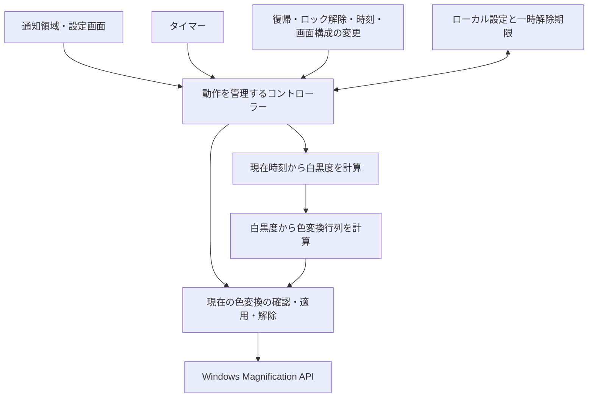

# 指定時刻から画面を徐々に白黒にする Windows アプリ 設計書

作成日: 2026-09-26

状態: 実装の基礎となった設計案。実装と検証の現状は `verification.md` を参照。

## 1. 目的と前提

夜のPC利用を終えて就寝に向かうきっかけを作るため、指定した時刻からデスクトップ全体の色を徐々にグレースケールにする。

今回明示された要件:

- デスクトップアプリとして動作する。
- 指定時刻から徐々にグレースケールへ移行する。
- 現段階では設計のみを行う。

これまでの会話を引き継いだ設計上の前提:

- Windows を対象とする。初版の対応対象は、Microsoft のサポート期間内にある Windows 11 x64 とする。
- 毎日繰り返し、朝の指定時刻にカラーへ戻す。
- 初期入力値は22:00開始、60分かけて白黒化、07:00復帰とする。初回は自動切替を無効にし、利用者が有効化して保存する。
- 通常のデスクトップ全体を一括で変換する。モニター別・アプリ別の設定は設けない。
- 本書の「カラーに戻す」は、本アプリが設定したグレースケール効果を解除することを指す。

初版の正式な対応範囲は通常のSDRデスクトップとする。複数モニターへの一括適用を目標とするが、後述の実機確認をリリース条件とする。HDR、独占全画面ゲーム、保護された動画、リモートデスクトップ、Windows ARM64、ロック画面・UACのセキュアデスクトップは初版の動作保証対象に含めない。

製品名は「おやすみグレー for Windows」、プロジェクト名は `oyasumi-gray-windows` とする。既存の Chrome 拡張 oyasumi-gray とは設定・実行ファイルを分ける。

## 2. 利用体験

### 2.1 通常の一日

| 時刻の例 | 画面の状態 |
| --- | --- |
| 07:00〜22:00 | 本アプリの白黒効果なし |
| 22:00 | 白黒度0%から移行開始 |
| 22:15 | 白黒度25% |
| 22:30 | 白黒度50% |
| 23:00〜翌07:00 | 白黒度100% |
| 翌07:00 | 効果を解除 |

途中で起動した場合、例えば22:30なら50%を適用する。スリープ復帰時も現在時刻から計算する。再起動や一時解除でスケジュールの開始時刻を後ろへずらさない。

開始から白黒になるまでを滑らかに変え、朝の復帰と手動解除は即時に行う。起動・復帰時はその時刻の濃さへ直接合わせるため、これらの場面では色が一度に変わる場合がある。

### 2.2 画面と操作

通常は通知領域に常駐する。初回起動時だけ設定画面を開き、以後のログオン起動は通知領域だけに表示する。

設定画面:

- 現在の状態: 「開始前」「移行中・白黒度50%」「白黒表示中」「一時解除中」「自動切替はオフ」「競合のため停止」「適用できません」。
- 次の切替時刻と、保存済み設定から計算した白黒になる時刻。
- 自動切替の有効・無効。
- 色が薄れ始める時刻。
- 白黒になるまでの時間（分）。
- カラーに戻る時刻。
- 設定を保存するボタン。
- 現在の状態に応じた「15分だけカラーに戻す」「自動切替を再開」「今すぐカラーに戻して停止」。
- 「Windowsへのログオン時に起動」の設定。初期値はオフ。

入力を編集しても保存するまでは画面に反映しない。保存前に「22:00から薄れ始め、23:00に白黒、07:00にカラーへ戻る」のような予告を表示する。保存成功後は新しい設定と現在時刻から即時に再計算する。

設定画面の閉じるボタンはウィンドウだけを閉じ、常駐は続ける。「この画面を閉じても通知領域で動作します」と画面内に記載する。

通知領域のメニュー:

1. 現在の状態（操作できない表示行）。
2. 設定を開く。
3. 15分だけカラーに戻す／自動切替を再開。
4. 今すぐカラーに戻して停止。
5. 終了。

「停止」は自動切替をオフにする。再開は利用者が明示的に行う。「終了」は常駐を終了するが、保存済みの有効設定は変更しないため、次回起動時にはスケジュールを再開する。

表示の成否を区別する。API呼び出しが失敗しているのに「白黒表示中」とは表示しない。画面の色だけに頼らず、文字で状態を伝える。

UIにはWindowsの標準コントロールを使い、時刻は24時間表記とする。キーボード操作、読み上げ用ラベル、Windowsの文字サイズ・高DPI設定に対応する。グローバルショートカットは初版に追加しない。

### 2.3 一時解除

- 適用時間帯に限り、操作時点から15分だけ本アプリの効果を解除する。
- 期限が朝の復帰時刻を超える場合は、朝の復帰時刻を期限にする。
- 再度押した場合はその時点から15分へ更新し、15分ずつ累積しない。
- 期限後は、その時刻のスケジュール上の白黒度に戻す。
- 設定を保存しても一時解除期限を消さない。ただし、設定変更後の適用区間の外ではカラーとし、期限を翌日分へ延長しない。
- 通常の設定保存や再起動をまたいで期限を保持する。

## 3. 方式の比較と採用案

| 評価軸 | A: C# + WinForms + Magnification API | B: Electron + Windows用の色制御プロセス | C: 画面取得・加工・重ね合わせ |
| --- | --- | --- | --- |
| 要件適合性とシンプルさ | 常駐・設定画面・色変更を1プロセスで扱える | 小さな設定画面にブラウザ実行環境とプロセス間通信が加わる | 画面の描画自体をアプリ側で扱う必要がある |
| 概念モデルの一貫性 | デスクトップ全体へ1つの白黒度を適用する操作と一致 | 同じ動作を実現できるが、UIと色制御の状態同期が必要 | 表示用ウィンドウと元の画面の関係、入力の通過を扱う必要がある |
| 性能・効率・コスト | OSの色変換を利用し、アプリは係数を更新する | 色変換部分はAと同じ。追加の実行環境が必要 | フレーム取得・変換・表示を継続する設計になり、負荷と遅延の検証範囲が増える |
| 並行性・データ整合性 | 色変更の呼び出し元を1か所に集約できる | 2プロセス間の切断・古い命令への対処が加わる | 取得と描画、モニター変更などを同期させる必要がある |
| 安全性・耐障害性 | 他ソフトとの競合と終了時の効果解除に集中できる | 色制御プロセスだけ残る場合への対処が必要 | 保護された画面、重ね合わせの消失、入力の妨害などが追加の検討対象になる |

Aを採用する。性能欄は構成からの評価であり、実測結果ではない。

技術構成は C#、.NET 10 LTS、WinForms、Windows標準のMagnification APIとする。.NET 10は2028-11-14までのLTS対象であることを確認した。具体的なパッチ版は実装開始時にサポート中のものへ固定する。[.NETのサポート方針](https://dotnet.microsoft.com/en-us/platform/support/policy/dotnet-core)

WinFormsは通知領域用の `NotifyIcon` を備えている。初版の小さな設定画面と常駐メニューに適している。[NotifyIcon](https://learn.microsoft.com/en-us/dotnet/desktop/winforms/controls/notifyicon-component-windows-forms)

Windowsのカラーフィルターをショートカットで切り替える方式は、今回必要な任意の中間濃度の制御に採用しない。`SetDeviceGammaRamp` も採用しない。後者はRGB各チャンネルの変換を扱い、Microsoftも使用を強く推奨していない。[SetDeviceGammaRamp](https://learn.microsoft.com/en-us/windows/win32/api/wingdi/nf-wingdi-setdevicegammaramp)

## 4. アプリの構成

責務と境界:

| 要素 | 入力と出力・責務 |
| --- | --- |
| 設定・通知領域UI | 利用者の操作をコマンドにし、実際の適用結果を表示する。直接APIを呼ばない |
| スケジュール計算 | 設定、現在日時、タイムゾーン、一時解除期限から、目標の白黒度・状態・次の境界日時を返す。Windows APIに依存しない |
| 色変換行列の計算 | 白黒度0〜1から5×5行列を返す。時刻や設定保存に依存しない |
| 動作コントローラー | 設定変更・タイマー・OSイベントを受け、次の状態と色変更を順番に実行する |
| Windowsの色制御 | 初期化、現在行列の取得、行列設定、解除、終了処理を担当する。スケジュールを知らない |
| 設定の保存 | 検証済み設定と一時解除期限を保存・復元する。画面の色は変更しない |
| Windowsとの連携 | 通知領域、同一セッション内の多重起動防止、ログオン起動、OSイベントを扱う |

1つの対話型ユーザーセッション内で動く常駐プロセスとする。Windowsサービスは使用しない。同一セッション内の名前付きMutexで多重起動を防ぐ。2回目の起動は「通知領域から設定を開いてください」と表示して終了する。初版ではウィンドウ転送用の独自IPCを追加しない。

色制御APIの呼び出しは1つのスレッドに集約する。設定保存中も入力に応答できるよう、ファイルI/Oは非同期に行うが、結果を反映する状態変更はコントローラーで直列化する。保存中の再保存は無効化し、タイマーイベントは最新の1件にまとめる。古い日時で計算した結果を後から適用せず、処理時点で再計算する。

保存先ごとに書き込み順序も直列化する。保存中に停止・一時解除を受けた場合は、その操作をメモリー上で直ちに反映し、先行する保存の完了によって解除状態を取り消さない。先行処理の完了後に最新の設定・期限を保存する。明示的な再開操作だけが、この解除状態を取り消せる。

## 5. 時刻と濃度の仕様

### 5.1 スケジュール

設定値はローカル時刻の開始時刻、移行分数、復帰時刻とする。開始から次に訪れる復帰時刻までを適用区間 `[開始, 復帰)` とする。日付をまたぐ区間を扱う。

- 移行時間: 整数の1〜360分。
- 開始と復帰が同じ時刻: 保存不可。
- 移行時間が通常日の適用区間以上: 保存不可。
- 適用区間外: 白黒度0。
- 適用区間内: `p = clamp((現在日時 − 開始日時) / 移行時間, 0, 1)`。
- 無効化中、一時解除中、競合・異常による停止中: 自動的に新しい色変換を適用しない。

時刻はOSの現地時刻に追従する。時計やタイムゾーンが変わった場合は再計算し、白黒度が減ることも許容する。過去に何回タイマーが動いたか、アプリが何分起動していたかを進捗にしない。

夏時間がある地域では、存在しない時刻はその日の時計の進み幅だけ後ろへずらす。重複する時刻は最初の出現を選ぶ。移行時間は実経過時間で計算し、復帰時刻を優先する。夏時間で区間が短くなった日には100%に達しない場合がある。補正後に復帰日時が開始日時以前となる区間はその日に限って適用せず、次の区間を待つ。

一時解除期限はUTCの絶対日時として保持する。現在時刻に対して期限切れなら無視する。時計の手動変更で残り時間も変わる仕様とする。

### 5.2 色変換

通常色を表す単位行列を `I`、グレースケール行列を `G`、白黒度を `p` として、`M(p) = (1 − p)I + pG` を適用する。

`G` ではRGBの重みを0.2126、0.7152、0.0722とし、赤・緑・青の出力を共通の値へ変える。アルファと定数成分は変えない。行列の並びはWindows APIの仕様に合わせる。係数が有限値であること、`p` が0〜1であることをAPI呼び出し前に確認する。独自の倍率変更や入力座標の変換は行わない。

これは表示色の補間であり、移行率と人が感じる彩度の変化が厳密に比例することは保証しない。初版は補間カーブの選択機能を追加せず、時間に対して線形に変える。

`MagSetFullscreenColorEffect` はデスクトップ全体へ5×5の色変換を適用する公式APIである。初期化には `MagInitialize`、現在値の取得には `MagGetFullscreenColorEffect`、終了処理には `MagUninitialize` を使う。[色変換API](https://learn.microsoft.com/en-us/windows/win32/api/magnification/nf-magnification-magsetfullscreencoloreffect) / [API概要](https://learn.microsoft.com/en-us/windows/win32/winauto/magapi/magapi-intro)

### 5.3 更新間隔

| 状態 | 通常の確認間隔 |
| --- | --- |
| 移行中 | 1秒 |
| 開始待ち・白黒維持・一時解除 | 次の境界までの時間と30秒の短い方 |
| 自動切替がオフ | 定期処理なし |
| 競合・異常で停止 | 自動再適用なし。明示的な再開操作を待つ |
| ロック・スリープ中 | 色変更を行わない |

通常のタイマーを使い、OSのタイマー分解能を引き上げない。1分の移行でも1秒当たり約1.67ポイント、60分なら約0.028ポイントの変化となる。視覚的な滑らかさは実機確認対象とする。

行列が変わる場合だけ書き込み、毎回の更新を設定ファイルへ保存しない。スリープ・ロック解除、時刻変更、画面構成変更を受けた場合はイベントで再評価する。停止しているOSを指定時刻に起こす機能は設けない。

## 6. 他の色変更との競合

このAPIは共有の色変換状態を変更し、最新の設定が使われる。APIには所有者識別や比較と更新を原子的に行う機能がない。アプリ内での直列化と外部アプリとの競合防止は区別する。[APIの動作](https://learn.microsoft.com/en-us/windows/win32/api/magnification/nf-magnification-magsetfullscreencoloreffect)

初版では次の方針とする。

1. 自分の効果をまだ適用していないときは現在行列を読む。単位行列なら適用を開始できる。
2. 既に別の非単位行列が設定されている場合は、初版では合成せず「他の画面の色変更を確認してください」と表示して停止する。
3. 適用成功後、その行列をメモリーに保持する。
4. 続けて変更・解除するときは現在行列を読み、直前に自分が書いた値と比較する。維持中も30秒以内に確認する。
5. 差が許容誤差を超えた場合は、外部変更または表示状態の変化として書き込みを止める。カラーへ戻すための上書きも自動では行わない。
6. 利用者が競合を解消して「自動切替を再開」を選んだら、現在値を再確認して開始する。

行列比較は各要素の絶対差 `1e-4` 以下を同等とみなす。この値は初版の設計値で、APIの読み戻し精度を実機で確認する。倍率や入力座標には触れない。

現在値を読んだ直後に別アプリが書く競合は、このAPIだけでは完全に防げない。また、同じ行列を使う他アプリを識別することもできない。そのため、同じAPIで色を変更するソフトとの同時利用は初版の保証範囲外とし、頻繁な再適用で競合に対抗しない。

Windowsのカラーフィルター、夜間モード、GPUの色設定は別の仕組みで作用する可能性があり、この比較だけですべてを検知できるとは扱わない。既存のChrome拡張と同時に有効にすると表示効果が重なるため、デスクトップ版を利用するときは拡張側の自動切替をオフにする案内を出す。

## 7. 復帰・終了・失敗時の動作

### 7.1 通常の解除

朝の復帰、一時解除、停止、終了では、自分が設定した効果が現在も残っていることを確認してから単位行列へ戻す。すでに単位行列なら書き込み不要とする。成功したら、自分の効果を適用中という状態を解除する。

APIの戻り値が失敗の場合は、解除できたと表示しない。失敗した操作名と時刻を記録し、自動更新を止める。終了操作時に解除できない場合は設定画面を開き、「もう一度カラーに戻す」と「このまま終了」を表示する。

### 7.2 スリープ・ロック・画面構成の変更

ロックやスリープに入る通知を受けた場合は、可能であれば現在の自分の効果を解除する。ただし、通知が届くタイミングや別デスクトップへの切替によって、解除が完了することは保証しない。処理を長時間待たせてWindowsの終了や休止を妨げない。

復帰・ロック解除・画面構成変更後は現在行列を読み直す。単位行列なら現在時刻に応じて再開できる。同じプロセスが最後に書いた値が残っている場合も、その記録との一致を確認して継続できる。それ以外の値、またはAPI失敗の場合は競合・異常停止へ移る。復帰通知を受けただけで他の色設定を無条件に上書きしない。

### 7.3 強制終了・クラッシュ後

通常終了では解除を試みるが、タスクマネージャーによる強制終了、プロセスのクラッシュ、OS停止時には終了処理を保証できない。Windowsがその際に自動解除するかは、実機確認まで前提にしない。

次回起動時に非単位行列が残っていた場合、前回の自分の効果か別アプリのものかを断定しない。自動適用を停止し、設定画面に「現在の画面の色変更を解除する」操作を表示する。この操作だけは、利用者が現在の変換を解除することを確認したうえで単位行列を明示的に設定する。通常の自動解除と区別する。

初版では別の監視プロセスや常駐サービスを追加しない。強制終了後も自動で必ず復帰することが必須要件になった場合は、プロセス構成を再検討する。

### 7.4 保存失敗

通常の設定保存は、検証とファイル更新が成功してからメモリーの有効設定を切り替える。保存失敗時は入力を保持し、直前の保存済み設定で動き続ける。

一時解除と「今すぐカラーに戻して停止」は、設定保存の成功を待たずに画面を戻す操作を優先する。保存が失敗した場合は、そのプロセス内では解除・停止を維持し、「設定を保存できませんでした。再起動後は以前の設定が使われます」と表示する。色変更API自体が失敗した場合は別途、解除失敗を表示する。

## 8. データ保存

保存先は現在のWindowsユーザーのLocalApplicationData配下に `OyasumiGray.Windows` サブフォルダーを設ける。

設定ファイル:

| フィールド | 値 |
| --- | --- |
| schemaVersion | 1 |
| enabled | 自動切替の有効・無効 |
| startTime | 検証済み `HH:mm` |
| fadeDurationMinutes | 整数1〜360 |
| restoreTime | 検証済み `HH:mm` |

一時解除ファイルには `schemaVersion` と `pausedUntilUtc` のみを保存する。設定保存が一時解除期限を上書きしないよう、ファイルを分ける。期限切れの値は無視し、次の利用者操作で更新する。

書き込みは同じディレクトリの一時ファイルを経由して置き換える。各ファイルの置き換えだけを原子的に行い、2ファイル間のトランザクションは要求しない。設定ファイルと期限ファイルは、互いに矛盾せず独立して解釈できるようにする。

初版では各JSONファイルを16KiB以内とし、読み込み時にサイズ、型、範囲、schemaVersionを検証する。壊れたファイルや未対応バージョンを自動で上書きしない。色の自動適用を止め、設定画面から保存し直せるようにする。

現在の白黒度や毎秒の計算結果は保存しない。画面画像、閲覧URL、利用アプリ一覧、キー入力を取得・保存しない。エラーログは日時・処理名・結果に限定し、1MiBのファイルを最大2本保持する。外部通信は行わない。

ログオン起動への登録状態はWindowsの登録を正とし、JSONには重複保存しない。設定画面を開く際に実際の登録を確認する。登録済みでもWindows側で起動を無効にできるため、登録状態だけで実際の起動を保証する表示はしない。利用者がWindows側で行った無効化を自動的に取り消さない。

## 9. 起動と配布

- `win-x64` のWindows用実行ファイルとして配布する。.NETランタイムを同梱する自己完結型の配布を採用する。
- アプリはWindows側のローカルフォルダーに配置して実行する。WSLはソース管理に利用できるが、色制御はWindows上のプロセスから呼ぶ。
- 実行権限は通常ユーザーを前提とする。`uiAccess` を必要とする入力座標変換は使用しない。色変換が通常権限で使えることは実機の受け入れ条件とする。
- 64ビットWindows上の32ビット実行は対応しない。Magnification APIはWOW64をサポートしない。[APIの対応条件](https://learn.microsoft.com/en-us/windows/win32/winauto/magapi/magapi-intro)
- ログオン起動は利用者がオンにした場合だけ、現在ユーザーの `HKCU\Software\Microsoft\Windows\CurrentVersion\Run` に登録する。実行ファイルの絶対パスを引用符付きで記録し、登録可能な長さを超える場合は明示的にエラーにする。オフでは自分の値だけを削除する。[Runキーの仕様](https://learn.microsoft.com/en-us/windows/win32/setupapi/run-and-runonce-registry-keys)
- Windowsによるログオン起動は遅延する場合がある。起動時に現在時刻から濃度を計算するため、起動が遅れても移行を最初からやり直さない。
- 初版はバージョン付きZIPでの配布とし、更新はアプリを終了してからファイルを置き換える。自動更新は追加しない。
- 署名付きインストーラーやストア配布は、個人利用の初版を確認した後に別途検討する。

## 10. 状態遷移の要約

状態の優先順位は、終了処理中 → ロック・休止中 → 競合・異常停止 → 自動切替オフ → 有効な一時解除 → スケジュールの順とする。所有している色変換を解除する必要がある場合は、状態の表示だけ切り替えず、解除結果まで管理する。

| きっかけ | 遷移・処理 |
| --- | --- |
| 初回起動 | 自動切替オフで設定画面を開く |
| 有効化して保存 | 現在の色変換を確認し、現在時刻の状態へ |
| 開始時刻到達 | 移行中へ。初めて0%を超える時点で色変換を取得・設定 |
| 移行完了 | 100%で維持 |
| 朝の復帰時刻 | 自分の効果を解除し、次の開始待ちへ |
| 15分の一時解除 | 効果を解除し、一時解除中へ |
| 一時解除期限到達 | 現在値を確認し、現在時刻の白黒度へ |
| 今すぐカラーに戻して停止 | 効果を解除して自動切替オフへ。保存失敗時はそのセッション内で停止 |
| 他の行列への変更を検出 | 競合停止。自動上書きしない |
| API失敗 | 異常停止。状態を表示し、明示的な再試行を待つ |
| 正常終了 | 自分の効果を解除し、APIの終了処理を行って常駐を終了 |

## 11. 実装後の確認項目と受け入れ条件

以下は初版の受け入れ条件。実施済みの確認と残る確認は `verification.md` に記録する。

### 11.1 計算と状態管理

- 開始直前・開始ちょうど・移行途中・移行完了・復帰ちょうどで所定の濃度になる。
- 日付、月、年をまたいでも適用区間が正しい。
- タイムゾーン変更、時計の前後への変更、夏時間の欠落・重複を指定のルールで扱う。
- 0%、25%、50%、75%、100%の行列が正しく、アルファを変更しない。
- 設定保存と一時解除が同時に操作されても、古い状態を後から適用しない。
- 多重起動してもAPIを書き換えるプロセスは1つ。
- 外部変更を検出したら自動適用を停止し、解除時にも他者の値を上書きしない。ただしAPI自体に原子的な競合防止がない制約は残る。
- 保存失敗、読込失敗、API失敗を正常動作として表示しない。

### 11.2 Windows実機

- 通常ユーザー権限で、デスクトップ、タスクバー、ブラウザ、通常のアプリに0〜100%の変化が適用される。
- APIから読めた値だけでなく、表示を目視して中間濃度とカラー復帰を確認する。
- 拡大率、マウス位置、タッチ操作、ウィンドウ位置を変えない。
- 1分と60分の移行設定で、ちらつきや不自然な段差がない。
- 接続中の全SDRモニター、モニター追加・切断、解像度・DPI変更を確認する。
- ロック解除、スリープ復帰、ログオン起動で現在時刻の状態に復帰する。
- 正常終了、一時解除、停止で自分の効果が解除される。
- 強制終了後の実際の色の状態と、次回起動時の手動復帰経路を確認する。
- Windowsのカラーフィルター、夜間モード、拡大鏡との同時利用時の挙動を確認する。保証できない組合せは対応範囲に追加しない。
- 代表的なSDR動画再生とスクロールに支障がない。待機中と移行中のCPU・GPU負荷をアプリ停止時と比較し、継続的な高負荷がないことを確認する。
- HDRや保護動画等を試す場合は対応範囲拡大のための別検証とし、SDRでの成功から対応を推定しない。

通常の前景セッションでは、開始・移行完了・朝の復帰が設定時刻から2秒以内に反映されることを目標とする。OSの休止や高負荷で処理が遅れた場合は、次の実行機会に現在時刻へ追いつく。OSが停止中の厳密な時刻実行は保証しない。

実装の最初の判断条件は、通常ユーザー権限のWindows 11 x64で、倍率を変えずに段階的な色変換と解除が成立することである。ここが成立しなければ、他の構成の実装を進める前に方式を再検討する。

## 12. 初版に含めない機能

曜日別スケジュール、複数の適用時間帯、モニター別の濃度、アプリ別除外、クラウド同期、利用時間計測、閲覧の強制制限、自動更新、監視サービス、macOS/Linux対応は初版に追加しない。

将来これらが必要になった場合でも、今回の色制御APIで実現できるかを個別に評価する。特にアプリ別除外・モニター別制御を、現在の方式で容易に追加できるとは扱わない。
